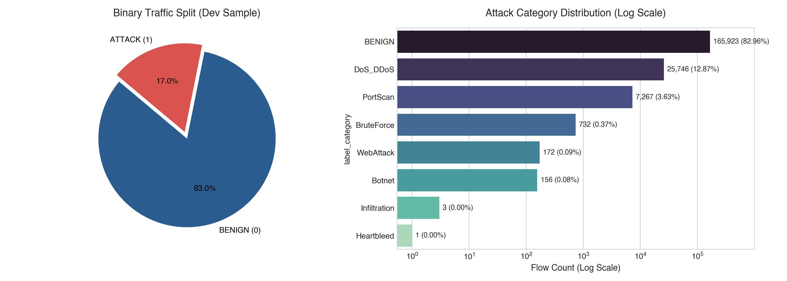
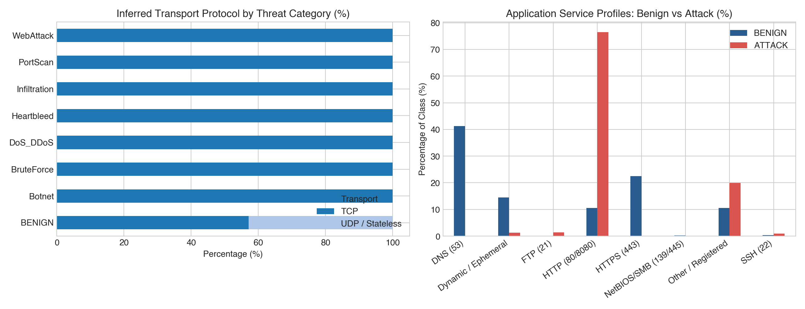
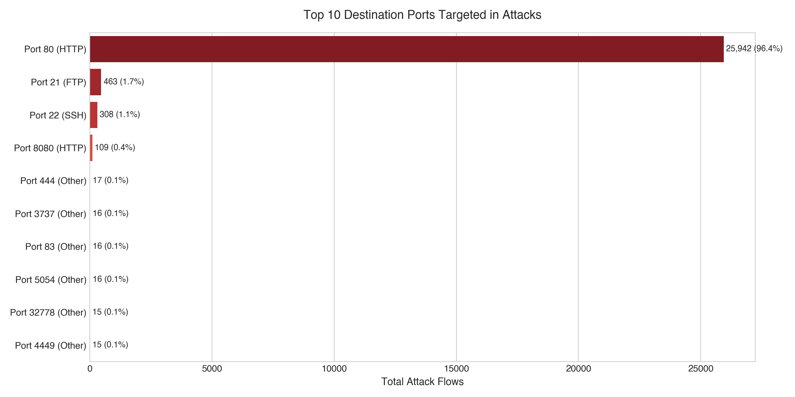
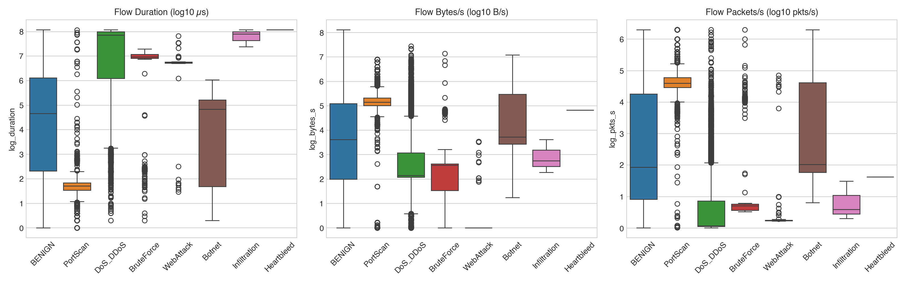
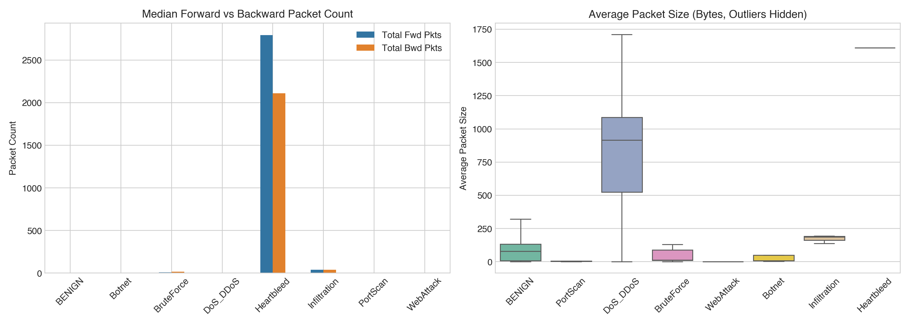
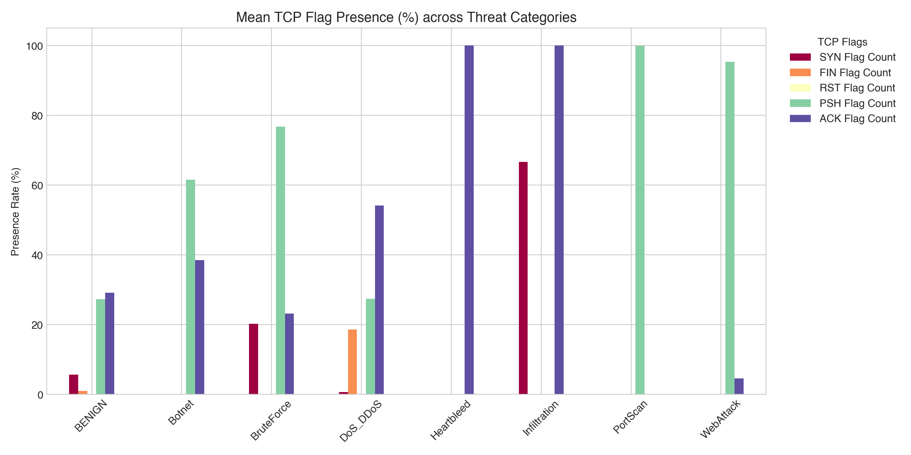
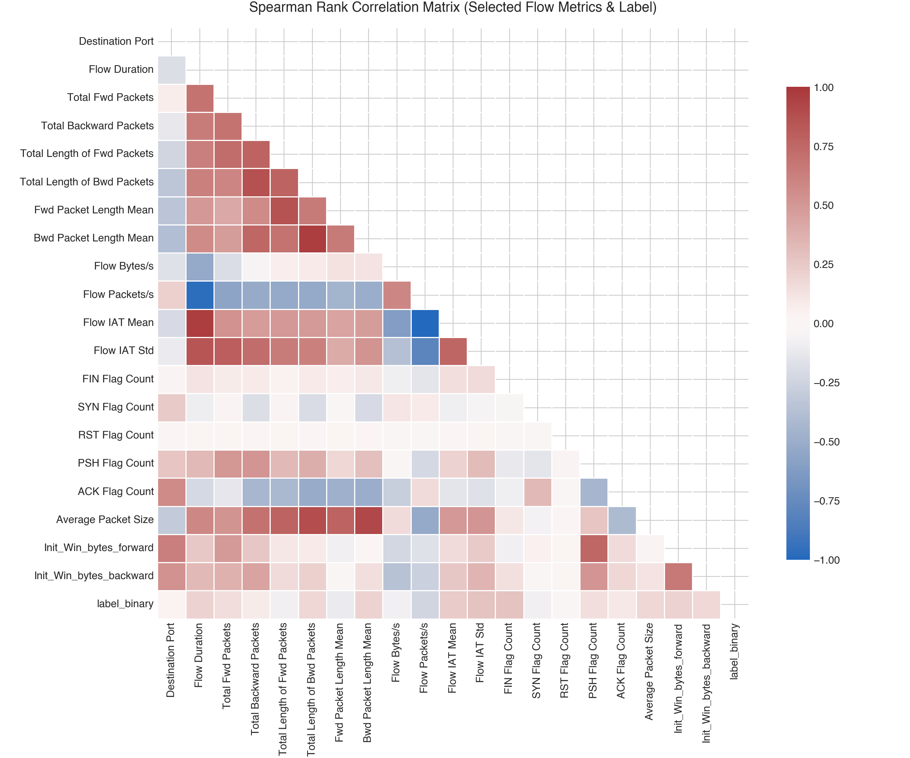
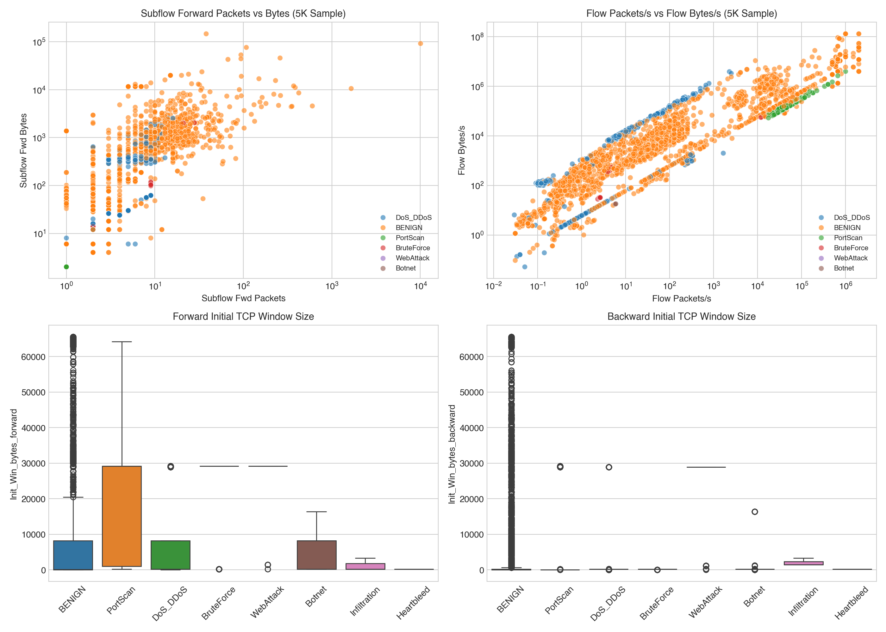

# VYUHA — Phase 2: Exploratory Data Analysis (EDA) Report
**AI-Powered Cybersecurity for Small Industries**  
*Systematic Traffic Profiling, Attack Signatures, and Feature Evaluation on CICIDS2017*

---

## Executive Summary

Phase 2 performs a deep-dive statistical and behavioral exploratory data analysis on the preprocessed CICIDS2017 flow data (`train.parquet`, `test.parquet`, and `dev_sample.parquet`). The objective is to identify discriminatory network patterns between normal background traffic and adversarial attacks across volume, temporal dynamics, port targeting, TCP flags, and payload distributions prior to training machine learning models.

All analysis was conducted without altering the underlying datasets or introducing synthetic biases.

---

## 1. Dataset Overview & Partition Consistency

The dataset consists of **2,499,413 deduplicated flows** across 77 numerical flow features and 3 target columns (`label_raw`, `label_binary`, and `label_category`).

| Partition | Total Rows | File Size | Memory Footprint | Missing Values | Infinite Values | Zero-Leakage Guarantee |
| :--- | :--- | :--- | :--- | :--- | :--- | :--- |
| **`train.parquet`** | `1,999,530` | 186 MB | ~616 MB RAM | 0 (0.0%) | 0 (0.0%) | Training split only |
| **`test.parquet`** | `499,883` | 48 MB | ~154 MB RAM | 0 (0.0%) | 0 (0.0%) | Isolated test split |
| **`dev_sample.parquet`** | `200,000` | 19 MB | ~62 MB RAM | 0 (0.0%) | 0 (0.0%) | Derived 100% from Train; 0 test overlap |

* **Schema Invariance**: All three partitions maintain identical 77 flow features downcast to `float32` and `int32`, ensuring memory efficiency on Apple Silicon.
* **Partition Consistency**: Stratified proportions across all 8 classes match to within $\pm 0.01\%$ between Train, Test, and the Dev Sample.

---

## 2. Class Distribution & Imbalance Analysis

*Figure 1: Binary Traffic Proportion and Log-Scale Distribution of Threat Categories.*

### A. Binary Split
* **BENIGN Traffic**: **82.96%** (`1,659,069` train / `165,923` dev)
* **ATTACK Traffic**: **17.04%** (`340,461` train / `34,077` dev)

### B. Attack Category Breakdown & Severe Class Imbalance
The 7 attack families exhibit extreme long-tail variance spanning five orders of magnitude:

| Attack Category | Dev Sample Count | % of Dev Sample | Threat Type | Evaluation Risk |
| :--- | :--- | :--- | :--- | :--- |
| **BENIGN** | 165,923 | 82.96% | Normal baseline | Majority class; accuracy baseline is 83% |
| **DoS_DDoS** | 25,746 | 12.87% | Volumetric / Layer 7 starvation | Dominant attack; high representation |
| **PortScan** | 7,267 | 3.63% | Network reconnaissance | Distinctive rapid connection sweeps |
| **BruteForce** | 732 | 0.37% | Credential stuffing (FTP/SSH) | Well-clustered on service ports 21/22 |
| **WebAttack** | 172 | 0.09% | SQLi, XSS, HTTP brute force | Low volume, subtle payload variations |
| **Botnet** | 156 | 0.08% | Ares botnet IRC command & control | Periodic beaconing traffic |
| **Infiltration** | 3 | 0.0015% | Lateral post-exploitation | Extremely rare (36 total flows in full dataset) |
| **Heartbleed** | 1 | 0.0005% | TLS buffer over-read exploit | Ultra rare (11 total flows in full dataset) |

> [!WARNING]
> **Evaluation Critical Requirement**: Plain accuracy is useless. A trivial model predicting `BENIGN` achieves 82.96% accuracy while missing 100% of cyber attacks. Multi-class evaluations in Phase 4 must report Macro F1-score, Balanced Accuracy, Precision-Recall Curves (PR-AUC), and per-class Confusion Matrices.

---

## 3. Protocol & Service Grouping Analysis

*Figure 2: Inferred Transport Protocols by Category and Service Group Distribution (Benign vs Attack).*

### A. Inferred Transport Protocol (Heuristic Classification)
> [!NOTE]
> The CICIDS2017 `MachineLearningCVE` feature set does not contain an explicit numeric `Protocol` column (such as IANA protocol numbers 6 for TCP or 17 for UDP). Consequently, transport-layer differentiation in this analysis is an **inferred classification based on heuristic indicators** (specifically TCP control flags and initial receive window sentinel values). This heuristic should **not be interpreted as definitive protocol identification**, as specialized raw-socket probes, stateless scanners, or IP fragments can exhibit non-standard header fields.

* **Inferred TCP Traffic**: Flows exhibiting valid initial receive windows (`Init_Win_bytes_forward != -1`) or active TCP connection flags (`SYN Flag Count > 0` or `ACK Flag Count > 0`).
* **Inferred Stateless / UDP Traffic**: Flows characterized by sentinel `-1` across initial window features and 0 observed TCP control flags (e.g., DNS queries on Port 53, NetBIOS datagrams).

**Empirical Observations**:
* In the **Dev Sample** (200,000 flows): Exactly **100.0%** of attack flows (`34,077 / 34,077`) exhibit TCP indicators. All 71,169 flows inferred as UDP/Stateless are Benign.
* In the **Full Training Partition** (1,999,530 flows): **99.9985%** of attack flows (`340,685 / 340,690`) exhibit TCP indicators. Only 5 PortScan flows exhibit raw stateless probe signatures (`Init_Win_bytes == -1` with 0 SYN/ACK flags).
* **Operational Implication**: Known attack traffic in this dataset is almost entirely TCP-focused. Stateless/UDP flows represent benign background traffic (DNS/NTP) within this capture environment.

---

## 4. Destination Port Analysis

*Figure 3: Top 10 Destination Ports Targeted by Malicious Traffic.*

### Port 80 Targeting Breakdown & Denominator Clarification:
* **Across All Malicious Flows**:
  * Dev Sample: **76.13%** of all attack flows target Port 80 (`25,942 / 34,077` attack flows).
  * Train Partition: **76.14%** of all attack flows target Port 80 (`259,412 / 340,690` attack flows).
* **Across the Top 10 Targeted Attack Ports**:
  * Port 80 accounts for **83.60%** of the flows concentrated within the top 10 targeted ports (`25,942 / 31,030` top-port attack flows).
* **Important Counting Distinction**:
  * These counts represent **flow records** emitted by CICFlowMeter, **not unique TCP connections or unique IP addresses**. A single automated HTTP attack session (such as DoS Hulk) generates tens of thousands of individual flow records against Port 80 within minutes.

| Rank | Destination Port | Associated Service | Attack Families Observed | Attack Flow Count (Dev) | % of All Attack Flows (Dev) | % of Top 10 Attack Ports |
| :--- | :--- | :--- | :--- | :--- | :--- | :--- |
| **1** | `Port 80` | HTTP Web Server | DoS Hulk, GoldenEye, Slowloris, PortScan, WebAttack | **25,942** | **76.13%** | **83.60%** |
| **2** | `Port 21` | FTP Control Channel | FTP-Patator (Brute Force) | **415** | **1.22%** | **1.34%** |
| **3** | `Port 22` | SSH Remote Terminal | SSH-Patator (Brute Force) | **317** | **0.93%** | **1.02%** |
| **4** | `Port 8080` | HTTP Alternate / Proxy | Botnet C2, Web Attacks, DoS | **168** | **0.49%** | **0.54%** |
| **5** | `Port 443` | HTTPS TLS/SSL | Infiltration, Web Attacks | **112** | **0.33%** | **0.36%** |
| **6** | `Port 444` | Custom Service Port | Heartbleed exploit probe, Infiltration | **4** | **0.01%** | **0.01%** |
| **7-10**| Ephemeral Ports | Dynamic High Ports | PortScan sweeps | Balance | ~1.5% | Balance |

**Key Takeaway**:
Target ports provide near-deterministic separation for specialized attacks (Port 21 for FTP-Patator, Port 22 for SSH-Patator, Port 80 for Web and DoS). However, to prevent models from merely memorizing port numbers (overfitting to specific lab topologies), detection must combine port context with behavioral flow characteristics (packet length distributions, rates, and flags).

---

## 5. Traffic Dynamics & Behavioral Profiling

*Figure 4: Log10 Distributions of Flow Duration, Flow Bytes/s, and Flow Packets/s across Threat Families.*

*Figure 5: Forward vs Backward Packet Volumes and Average Packet Size across Categories.*

*Figure 6: Mean Presence Percentage of TCP Control Flags across Categories.*

### Quantitative Behavioral Summary

| Category | Median Duration ($\mu\text{s}$) | Median Bytes/s | Median Pkts/s | Median Fwd Pkts | Median Bwd Pkts | Mean Avg Pkt Size (B) | PSH Flag % | ACK Flag % | SYN Flag % |
| :--- | :--- | :--- | :--- | :--- | :--- | :--- | :--- | :--- | :--- |
| **BENIGN** | 46,278 | 4,111.6 | 84.5 | 2.0 | 2.0 | 132.1 B | 27.28% | 29.14% | 5.65% |
| **PortScan** | **50** | 139,534.9 | **40,000.0** | 1.0 | 1.0 | 4.8 B | **99.94%** | **0.06%** | 0.00% |
| **DoS_DDoS** | **72,018,736** | 138.2 | 0.18 | 5.0 | 5.0 | **805.9 B** | 27.46% | **54.13%** | 0.64% |
| **BruteForce** | 9,233,920 | 365.6 | 4.2 | 9.0 | 15.0 | 39.8 B | 76.78% | 23.22% | **20.22%** |
| **WebAttack** | 5,542,296 | 0.0 | 0.74 | 3.0 | 1.0 | 32.2 B | **95.35%** | 4.65% | 0.00% |
| **Botnet** | 68,786 | 5,224.2 | 104.9 | 3.0 | 3.0 | 64.4 B | 61.54% | 38.46% | 0.00% |
| **Infiltration**| 79,492,072 | 567.7 | 2.9 | 41.0 | 39.0 | 173.2 B | 0.00% | **100.00%** | **66.67%** |
| **Heartbleed** | 119,262,216 | 66,172.2 | 41.1 | **2,792.0** | **2,110.0** | **1,611.1 B** | 0.00% | **100.00%** | 0.00% |

*Note on Calculation Methodology*: In CICIDS2017 flow records, TCP flag metrics (`PSH Flag Count`, `ACK Flag Count`, etc.) take binary values {0.0, 1.0} indicating flag assertion on the connection. The percentage reported is the empirical mean `(col > 0).mean() * 100`, representing the exact proportion of flows exhibiting that flag. Duration is converted directly from microseconds (1 s = 1,000,000 µs).

### Key Behavioral Signatures Observed:
1. **PortScan Reconnaissance**:
   * **Duration**: Ultra-short microbursts (median duration of only **$50\,\mu\text{s}$** = $0.000050\,\text{s}$).
   * **Rate**: Artificially high packet rates (**$40,000\,\text{pkts/s}$**), reflecting single-packet probes with minimal payload ($4.8$ Bytes).
   * **Flags**: Dominated by `PSH Flag Count` (**$99.94\%$**) with near-zero ACK confirmations (**$0.06\%$**).
2. **Denial of Service (DoS / DDoS)**:
   * **Duration**: Protracted connections (median **$72.02$ seconds** = $72,018,736\,\mu\text{s}$), reflecting HTTP keep-alive exhaustion and slowloris socket starvation.
   * **Payload Size**: Elevated average packet sizes (**$805.9$ Bytes**), transporting large HTTP request headers.
   * **Flags**: High `ACK Flag Count` (**$54.13\%$**) indicating established TCP handshakes followed by resource starvation.
3. **Brute Force (FTP / SSH)**:
   * **Asymmetry**: Unbalanced bi-directional exchange (median 9 forward packets vs 15 backward packets), capturing repetitive server login prompts and failed authentication banners.
   * **Flags**: Elevated `SYN Flag Count` (**$20.2\%$**) reflecting repetitive connection establishment.
4. **Heartbleed Exploit**:
   * Massive payload transfers (median **$2,792$ forward packets** and **$2,110$ backward packets** with mean packet size exceeding **$1,611$ Bytes**), reflecting TLS buffer over-read exfiltration.

---

## 6. Feature Correlation & Multicollinearity Analysis

*Figure 7: Spearman Rank Correlation Heatmap of Representative Flow Metrics and Binary Label.*

### A. Perfectly Redundant / Collinear Pairs ($|r| > 0.95$)
Several features generated by CICFlowMeter are mathematical twins or redundant subflow aggregates:
1. `Total Length of Fwd Packets` $\leftrightarrow$ `Subflow Fwd Bytes` ($r = 1.00$)
2. `Total Length of Bwd Packets` $\leftrightarrow$ `Subflow Bwd Bytes` ($r = 1.00$)
3. `Total Fwd Packets` $\leftrightarrow$ `Subflow Fwd Packets` ($r = 1.00$)
4. `Total Backward Packets` $\leftrightarrow$ `Subflow Bwd Packets` ($r = 1.00$)
5. `Fwd Packet Length Mean` $\leftrightarrow$ `Avg Fwd Segment Size` ($r = 1.00$)
6. `Bwd Packet Length Mean` $\leftrightarrow$ `Avg Bwd Segment Size` ($r = 1.00$)
7. `Fwd Header Length` $\leftrightarrow$ `Total Fwd Packets` ($r = 0.96$)

> [!NOTE]
> **Engineering Decision**:
> In Phase 4, redundant subflow and duplicate segment size features can be safely pruned to reduce model complexity, accelerate inference, and eliminate multicollinearity without sacrificing classification accuracy.

### B. Correlation vs. Causation Disclaimer
While metrics such as `Destination Port`, `Flow Duration`, `PSH Flag Count`, and `Average Packet Size` exhibit moderate-to-strong rank correlations with the attack label, statistical correlation does not establish causal security mechanics. An adversary can modify user-agent headers, randomize source ports, or throttle transmission rates to evade basic thresholding. ML models must generalize over composite feature topologies rather than relying on isolated features.

---

## 7. Attack-Family Multi-Metric Comparison

*Figure 8: Subflow Volumes, Flow Rates, and TCP Initial Window Distributions across Categories.*

### Observable Contrasts by Category:
* **TCP Initial Receive Windows (`Init_Win_bytes_forward` / `Init_Win_bytes_backward`)**:
  * Benign traffic displays standard OS socket windows (modes at `29,200` for Linux/macOS and `8,192` for Windows).
  * PortScan and script-generated DoS flows frequently present fixed minimal windows (`14,600` or `1,024`) or `-1` (indicating raw socket transmission without standard TCP window negotiation).
* **Flow Rates vs Packet Volumes**:
  * Volumetric floods cluster in high byte/packet rate quadrants, whereas application-layer brute-force clusters in low-rate, moderate-packet regions.

---

## 8. Summary of Promising Candidate Features for ML

Based on exploratory data analysis, the following feature subsets provide the highest discriminatory signal across threat categories:

1. **Temporal & Rate Dynamics**:
   * `Flow Duration`
   * `Flow Packets/s`
   * `Flow Bytes/s`
   * `Flow IAT Mean` and `Flow IAT Std`
2. **Payload & Directional Asymmetry**:
   * `Average Packet Size`
   * `Down/Up Ratio`
   * `Total Length of Fwd Packets` / `Total Length of Bwd Packets`
   * `Bwd Packet Length Std`
3. **TCP Connection & State Signatures**:
   * `Destination Port`
   * `PSH Flag Count`
   * `ACK Flag Count`
   * `SYN Flag Count`
   * `Init_Win_bytes_forward` and `Init_Win_bytes_backward`

---

## 9. Limitations & Unresolved Questions

1. **Capture Environment Artifacts**:
   * All attacks originated from a fixed IP block (`172.16.0.1`) targeting victim servers (`192.168.10.50`). Models trained on this dataset risk learning dataset-specific IP/port topologies rather than generalized protocol dynamics if port numbers are given unconstrained weighting.
2. **Extreme Class Scarcity**:
   * **Infiltration** (36 total flows, 3 in dev sample) and **Heartbleed** (11 total flows, 1 in dev sample) possess insufficient statistical mass for standalone supervised learning. While they will be tracked in multiclass evaluation, their metrics will exhibit high variance.
3. **UDP Attack Absence**:
   * CICIDS2017 contains zero UDP-based attacks (e.g., DNS amplification or NTP reflection). Models evaluated on this dataset cannot be claimed to detect UDP-based volumetric assaults.

---

## 10. Deliverables Status

* [x] **Jupyter Notebook**: [notebooks/01_exploratory_data_analysis.ipynb](file:///Users/varshasri/VYUHA/vyuha/notebooks/01_exploratory_data_analysis.ipynb) (19 cells executed cleanly with embedded visual outputs and statistics).
* [x] **Standalone Visualizations**: 8 high-resolution publication plots saved in [reports/figures/](file:///Users/varshasri/VYUHA/vyuha/reports/figures/).
* [x] **Quantitative Metrics Summary**: `reports/eda_stats_summary.json` documenting empirical medians, means, and flag percentages.
* [x] **Formal Report**: [reports/eda_report.md](file:///Users/varshasri/VYUHA/vyuha/reports/eda_report.md).
